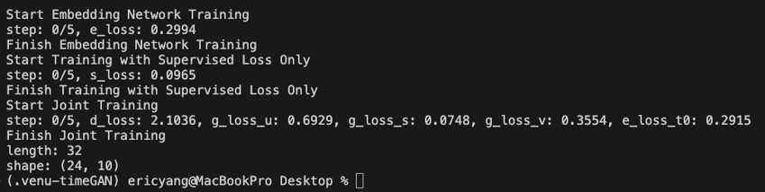
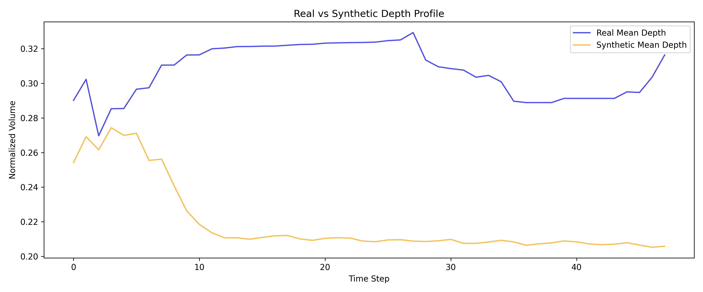
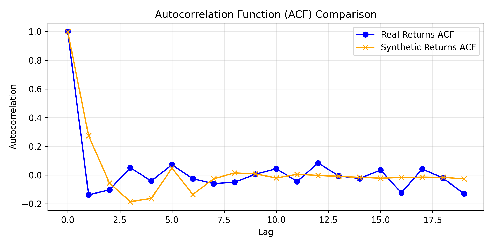
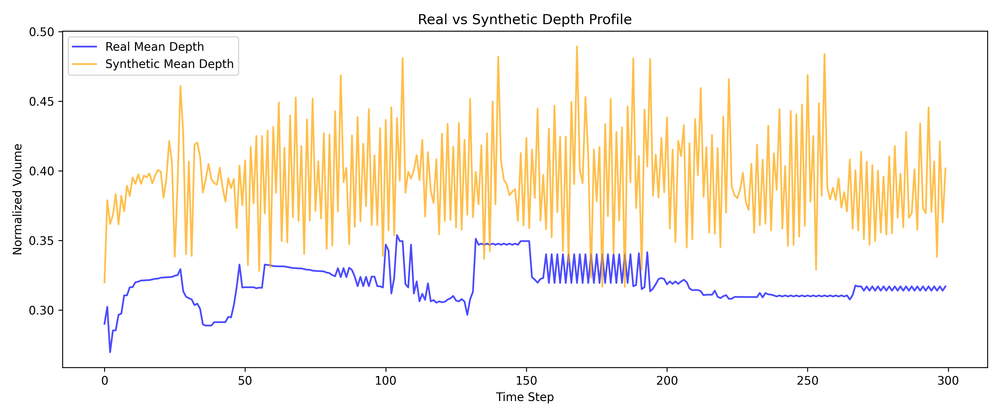
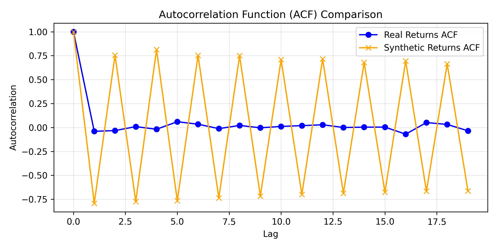
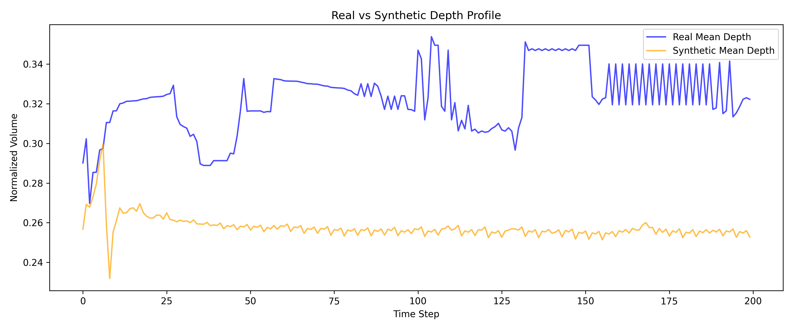
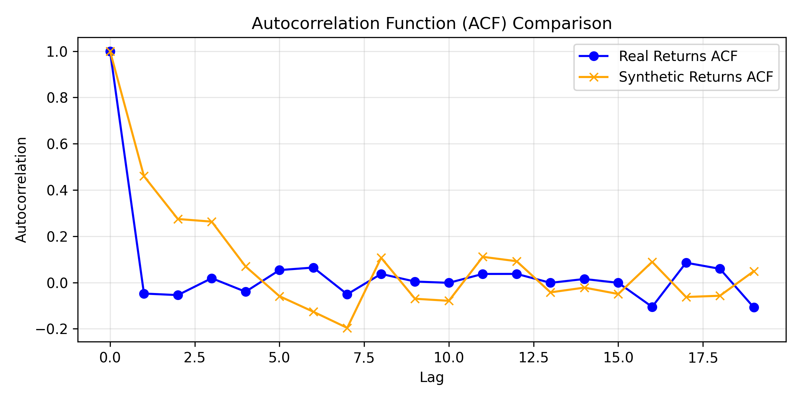
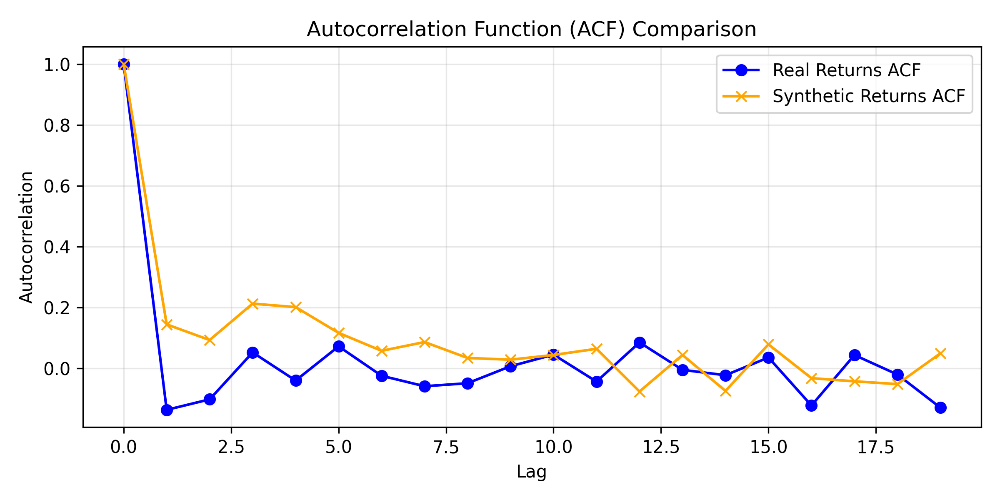

# Report on Time Series Model TimeGAN and predicting Limit Order Books
By Eric Yang

## Overview

This project aims to determine TimeGAN's effectiveness on generating limit order books. Specifically, if TimeGAN's joint supervised temporal loss and unsupervised adversial loss can actually learn and enforce the hard structural constraints of a limit order book. We determine TimeGAN's effectiveness by training the model using a limit order book created from a real day of stock trading on the Amazon stock. We then will compare these metrics with a simple baseline statistical model. And determine if the difference in results is worth the computational requirements of running TimeGAN.


---

<div align="center">

</div>

TimeGAN paper: [Time-series Generative Adversarial Networks](https://proceedings.neurips.cc/paper_files/paper/2019/file/c9efe5f26cd17ba6216bbe2a7d26d490-Paper.pdf)

---

## Table of Content
1. [Introduction](#introduction)
2. [Directory Structure](#directory-structure)
3. [Feasibilty Review](#feasibilty-review)
4. [Algorithm](#algorithm)
5. [Dataset](#dataset)
6. [Models and Architectures](#models-and-architectures)
7. [Joint Loss Training (Mathematical Reasoning)](#joint-loss-training-mathematical-reasoning)
8. [Training](#training)
9. [Tests and Failed Models](#tests-and-failed-models)
10. [Evaluation](#evaluation)
11. [Comparison with Baseline Model](#comparison-with-baseline-model)
12. [Conclusion](#conclusion)
13. [Reproducibility](#reproducibility)
14. [References](#references)
15. [Artificial Intelligence Usage Disclosure](#artificial-intelligence-usage-disclosure)
## Introduction
This project took the TimeGAN model, as illustrated in the TimeGAN paper, and attempted to determine the effectiveness of joint loss functions on capturing the underlying distribution of limit order book. Limit order books are special as time is extremely important in the price of any given stock. Additonally, limit order books are extremely useful for a wide range of activities, from actual trading, to stress testing various algorithms. And such, we are attempting to test the timeGAN model on a very complex and vital piece of financial investing.

## Directory Structure
```
|-- README.md                          # Project documentation
|-- requirements.txt                   # Python dependencies
|-- dataset.py                         # Dataset loading and preprocessing
|-- modules.py                         # Model source code 
|-- train.py                           # Main training point
|-- predict.py                         # Inference and metric comparison script
|-- outputs                            # All experiment outputs
|   |
|   |-- real_lob_test.npy
|   |-- synthetic_lob_train.npy
```

---

## Feasibilty Review
**Topic:** Time-Series Generation

The project topic is time series generation. In high level investing, a limit order book displays a comprehensive record of all previous trading data. This book is highly valued for trading as its irrefutable data gives incredible insight for future trading. However, a limit order book that is accurate to milliseconds is highly expensive and requires constantly analysis of the market.

**User Need, Scope & Acceptance Criteria:**
The target users for this project are algorithmic trading developers, and market risk systems teams that can utilise limit order to stress-test execution strategies and risk models without paying prohibitive commercial data licensing fees.

**The desired acceptance criteria for this project are:**

    •	KL-divergence between real and synthetic distributions for spread and mid-price returns: (<= 0.1)
    •	 Structural Similarity on 2D depth snapshots (price levels × time steps): (SSIM > 0.6) 
    •	Auto correlation between ground truth and generated values: (<=0.1>).
    •	Training time for TimeGAN: (< 20 mins)
**Model Choice & Course Concepts:**
TimeGAN is a generative time-series model, trained using a learned embedding space with both supervised and unsupervised losses. Resulting, in the model being trained via supervised temporal and unsupervised adversarial loss. The dataset, that will be paired with TimeGAN, is the LOBSTER dataset. This dataset contains two .csv files, a ‘message’ and an ‘orderbook’ file. The message file gives information on trades, such as the time, type, order ID, size, price, and direction of trades. While, the orderbook file gives information on the asking price, asking size, bid price and bid size for any trade, this info is repeated at every depth. The depth is a ranking of best offers for a trade, where depth 1 is the best offer, and depth 10 is the worst offer.

**Preliminary Feasibility Evidence:**
A initial data audit was conducted, and the dataset was successfully downloaded from https://php.lobsterdata.com/info/DataSamples.php. A simple smoke test was run, to check if the model can train and generate synthetic data, this was the output:

 

**Risks, Budget & Fallback:**
The key technical risks for this project are the model results not being able to reproduce volatility clustering and collapsing into uncorrelated noise and not strictly conforming to hard economic and physical microstructure laws (price of bid < price of ask). The computing budget is the computational limit of the rangpur HPC clusters. As, those clusters will be used for all training and testing that require large amounts of computation. The next planned experiment is to implement the data pipeline and chronological integrity by applying log-returns transformation for prices and normalisation. Additionally, we should enforce strict chronological splitting to eliminate look-ahead bias. If the model is unable to produce reasonable results, the workable fallback is simplifying the adversarial network topology or reducing the depth from 10 to a lower number.


---
## Algorithm
TimeGAN main algorithm is the joint supervised temporal loss and unsupervised adversarial loss.

**Supervised Temporal Loss:** Supervised temporal loss is crucial for time-series data because it forces the generator to learn the step-by-step temporal dynamics of the real data rather than just random static distributions.The goal of the supervised temporal loss is to learn the conditionals from the latent codes. 

**Unsupervised Adversarial Loss:** Unsupervised adversarial loss comes from the discriminator trying to distinguish between real latent sequences and synthetic ones. It pushes the generator to create realistic overall distributions. The goal of unsupervised adversarial loss is to learn the distribution directly from the classifications of the latent codes.

**Joint Supervised Loss and Unsupervised Loss:**
By combining gradients from both loss functions during backpropagation, the generator learns to produce sequences that are distributionally realistic and enforce the hard structural time constraints

---

## Dataset

### Dataset Structure
We are given two csv files to use as training and testing data. The first file is a message csv file, this file has relevant info about the time and circumstances around the trade. While this info is useful, using some of these values make the problem quite complex and difficult for the model to find the distribution. So, for this given project, we only use the data from the orderbook csv file. This includes all 10 depth levels, meaning we have 40 coloumn of data to work with. These 40 coloumns are split by 4 metrics for each depth level. For a visual (the first number is the coloumn):

 	    1.) Ask Price 1: 	Level 1 Ask Price 	(Best Ask)
	    2.) Ask Size 1: 	Level 1 Ask Volume 	(Best Ask Volume)
	    3.) Bid Price 1: 	Level 1 Bid Price 	(Best Bid)
	    4.) Bid Size 1: 	Level 1 Bid Volume 	(Best Bid Volume)
        5.) Ask Price 2: 	Level 1 Ask Price 	(Second best Ask)
	    6.) Ask Size 2: 	Level 1 Ask Volume 	(Second best Ask Volume)
	    7.) Bid Price 2: 	Level 1 Bid Price 	(Second best Bid)
	    8.) Bid Size 2: 	Level 1 Bid Volume 	(Second best Bid Volume)
        ...
        37.) Ask Price 10: 	Level 1 Ask Price 	(Tenth best Ask)
        38.) Ask Size 10: 	Level 1 Ask Volume 	(Tenth best Ask Volume)
        39.) Bid Price 10: 	Level 1 Bid Price 	(Tenth best Bid)
        40.) Bid Size 10: 	Level 1 Bid Volume 	(Tenth best Bid Volume)

### Dataset Proprocessing and Sequence Creation

**Feature Extraction:**
We need to preprocess this data because raw price values in limit order book datasets are typically stored as large integers and vary wildly across different features and depth levels. To counteract this problem, the `load_lobster_csv` function processes the raw order book file by extracting Level 1 ask and bid prices to compute the mid-price, log-returns, and spread, combining them all into a pytorch tensor.

**Global Normalisation:**
Following feature extraction, the entire dataset undergoes global normalisation via `preprocess_lob_data`. This function applies Min-Max scaling, adjusting every column and converts their values into a range between 0 and 1 using the dataset's minimum and maximum values. This ensures that features with larger raw magnitudes do not disproportionately dominate  the neural network gradients during training.   

**Strict Chronological Splitting:**
Finally, because financial models require temporal context, the normalised data is transformed into structured inputs through sequence creation. The `create_sliding_windows` function slices the data into continuous windows of a sequence length variable (seq_len). Through `get_lobster_timeseries_dataset`, these sliding windows are then split chronologically allocating the earlier market hours to training and later hours to testing, which aims to eliminate look-ahead bias. 

---
## Models and Architectures
TimeGAN uniquely combines an autoencoder framework with adversarial networks by mapping features into a lower-dimensional latent space. Based on the implementation in modules.py, the architecture consists of five core sub-networks:

Embedder (E): Maps the original data space to a latent space via $h_t = e_X  ( h_S, h_{t-1}, x_t)$ using Gated Recurrent Units (GRUs).

Recovery (R): Maps the latent space back to the original data space via $\tilde x_t = r_X (e_t)$ to reconstruct inputs.

Generator (G): Generates synthetic representations directly in the latent space using random noise inputs: $h_t = g_S(\tilde h_S, \tilde h_{t-1}, z_t)$.   

Supervisor(S): Captures temporal dynamics in latent space


Discriminator (D): Distinguishes between real latent codes and synthetic codes generated by the network.: $\tilde y_t =( \overleftarrow u_t, \overleftarrow u_t) $

---

## Joint Loss Training (Mathematical Reasoning)

During the joint training phase, the model simultaneously
learns to encode features, generate representations, and iterate across time, by optimising multiple loss functions.

The first loss function is reconstruction loss. This loss function is used when reconstructing static and temporal latent codes into their feature representation:

$$\mathcal{L}_R = E_{s,x_1:T~p}[||s-\tilde s||_2 +\sum_t ||x_t - \tilde x||_2]$$

The second loss function is unsupervised adversarial loss. This loss function uses Binary Cross-Entropy and Logits Loss to evaluate the discriminator's ability to differentiate real latent codes from synthetic codes: 

$$L_U = E_{s,x_1:T~p}[\text log (y_S) + \sum_t \text log (y_t)] + E_{s,x_1:T~p}[\text log (1 - \tilde y_S) + \sum_t \text log (1 - \tilde y_t)]$$

The third loss function is supervised temporal loss. This loss function is used to ensure that the model accurately captures the temporal dynamics of the latent space by penalising errors when predicting the next sequential latent state:

$$L_S = E_{s,x_1:T~p}[\sum_t ||h_t -g_X(h_S.h_{t-1},z_t)||_2]$$

---
## Training
Before training, we have to determine the following hyperparameters (default values for short testing).
    
    BATCH_SIZE = 64
    SEQ_LEN = 24
    HIDDEN_DIM = 32
    NOISE_DIM = 32
    NUM_LAYERS = 2
    EPOCHS = 10 
    NROWS= 50000
    train_rate = 0.8

BATCH_SIZE is the size of batches for backpropagation. SEQ_LEN is the length of each time-series sliding window. HIDDEN_DIM is the size of the hidden feature representation inside the GRU recurrent layers across all TimeGAN sub-networks. NOISE_DIM is the dimensionality of the random noise vector (Z) sampled and fed into the Generator network. NUM_LAYERS is the number of stacked recurrent layers used within the sub-networks. EPOCHS is the total number of complete passes the training algorithm makes over the training dataset. NROWS is the maximum number of rows loaded from the raw LOBSTER CSV file, and train_rate is the chronological split ratio.

After some basic testing, the following parameters were used:

    BATCH_SIZE = 64
    SEQ_LEN = 48
    HIDDEN_DIM = 32
    NOISE_DIM = 32
    NUM_LAYERS = 2
    EPOCHS = 100
    train_rate = 0.8
    nrows = 200000

These hyperparameters were chosen via a manual grid search. I manually went through, BATCH_SIZE = [32, 64, 128], SEQ_LEN = [24, 48, 72, 96], NUM_LAYERS = [2, 3], and EPOCHS = [25, 50, 100, 200]

**Training Pipeline**:

1) Load the Amazon dataset from LOBSTER (depth 10) 
2) Preprocess the Amazon dataset and create time sequences using the `get_lobster_timeseries_dataset` function from `dataset.py`
3) Initialise the model using the `TimeGAN` class from `modules.py`
4) Train the model with the dataset and `train_timegan` function from `modules.py`
5) Generate synthetic outputs using `generate` from `modules.py`, and save them into a local folder

Run this pipeline with `python train.py`

---

## Results

Before we get on to the final results, lets look at previous examples of failed convergence.

**First failed test:** 

    BATCH_SIZE = 64
    SEQ_LEN = 50
    HIDDEN_DIM = 32
    NOISE_DIM = 32
    NUM_LAYERS = 2
    EPOCHS = 250 
    NROWS= 100000
    train_rate = 0.8

**KL divergence on returns:** 0.4861

**autocorrelation MSE:** 0.071966

**depth heatmap SSIM:** 0.6421

**Plots:**

<div align="center">

</div>
<div align="center">

</div>


**Second failed test:**

    BATCH_SIZE = 256
    SEQ_LEN = 75
    HIDDEN_DIM = 32
    NOISE_DIM = 32
    NUM_LAYERS = 2
     EPOCHS = 500
    nrows=200000

**KL divergence on returns:** 0.4861

**autocorrelation MSE:** 0.071966

**depth heatmap SSIM:** 0.9679

**crossed book arbitrage violations:** 0.00%

**Output:** 

    torch.cuda.OutOfMemoryError: CUDA out of memory. Tried to allocate 24.39 GiB. GPU 0 has a total capacity of 39.49 GiB of which 8.18 GiB is free. Including non-PyTorch memory, this process has 31.31 GiB memory in use. Of the allocated memory 9.21 GiB is allocated by PyTorch, and 21.58 GiB is reserved by PyTorch but unallocated. If reserved but unallocated memory is large try setting PYTORCH_CUDA_ALLOC_CONF=expandable_segments:True to avoid fragmentation.  See documentation for Memory Management  (https://pytorch.org/docs/stable/notes/cuda.html#environment-variables)


**Third failed test**

    BATCH_SIZE = 64
    SEQ_LEN = 48
    HIDDEN_DIM = 32
    NOISE_DIM = 32
    NUM_LAYERS = 2
    EPOCHS = 100
    nrows=200000


**KL divergence on returns:** 3.9648

**autocorrelation MSE:** 0.015142

**depth heatmap SSIM:** 0.5192

**microstructure_invariant_violations:** 0.00%

**Output:** 

    Pipeline finished in 1210.80 seconds.
    Synthetic Data Shape: torch.Size([40, 48, 42])
    dataset finished in 1.73 seconds
    training finished in 1210.80 seconds
    generating finished in 0.42 seconds

**Plots:**

<div align="center">

</div>

<div align="center">

</div>


**Fourth failed test**

    BATCH_SIZE = 64
    SEQ_LEN = 300
    HIDDEN_DIM = 32
    NOISE_DIM = 32
    NUM_LAYERS = 2
    EPOCHS = 300
    nrows=200000


**KL divergence on returns:**  2.5692

**autocorrelation MSE:** 0.500607

**depth heatmap SSIM:**  0.1603

**microstructure_invariant_violations:** 12.5%

**Output:** 
    generating synthetic sequences
    Pipeline finished in 3402.93 seconds.
    Synthetic Data Shape: torch.Size([40, 300, 42])
    dataset finished in 5.26 seconds
    training finished in 3402.93 seconds
    generating finished in 0.31 seconds
    Training pipeline successfully finished!

**Plots:**

<div align="center">

</div>

<div align="center">

</div>

## Strongest Test

    BATCH_SIZE = 64
    SEQ_LEN = 200
    HIDDEN_DIM = 32
    NOISE_DIM = 32
    NUM_LAYERS = 2
    EPOCHS = 200
    nrows=200000

**KL divergence on returns:** 0.4414

**autocorrelation MSE:** 0.031795

**depth heatmap SSIM:** 0.3951

**microstructure_invariant_violations:** 0.00%

**Output:**

    Pipeline finished in 3054.03 seconds.
    Synthetic Data Shape: torch.Size([40, 200, 42])
    dataset finished in 3.50 seconds
    training finished in 3054.02 seconds
    generating finished in 0.36 seconds
    Training pipeline successfully finished!

**Plots:**
<div align="center">

</div>

<div align="center">

</div>

---

## Evaluation

### Failed Tests

**First Failed Test:**
The first test was run before the timeGAN source code was changed from tensorflow to pytorch. This first test showed decent promise, as the autocorrelation and ssim scores were quite reasonable, with the kl-divergence being too high (target <=0.1). Additionally, this test was only ran on 100,000 rows. However, looking at the plots, we can see that the model collapsed into noise, the model fails to capture any of the real data distribution. This was likey due to the low values for sequence length and rows used for training and testing. Overall, a solid test for the first test.

**Second Failed Test:** 
The second test's goal was to test the how high the hyperparameters could be. And due to attempting very large values for hyperparameters, the gpu of the rangpur clusters could not handle the model size and VRAM requirements. It was likely that the increased batch size with squence length caused the VRAM problem.


**Third Failed Test:**
This was the first test, were the model was starting to learn the distribution of the real data. Although the metrics are quite terrible, and the plots show a big gap between the real and generated values. In the real vs synthetic depth profile, for around 20 time steps, the model captures the distribution quite well.

**Fourth Failed Test:**
This was one of the last test conducted, the number of epochs and time steps were the highest in all of testing. However, this model clearly doesn't manage to capture the distribution well. Looking at the plots, we can see a rapid and sharp oscillation between high and low values. Even though this oscillation is quite harsh, the model does capture the distribution more than other tests. Its a little hard to notice, but the oscillations become stronger around areas of high trading and lower, around areas of lower trading. This is clearly a sign of volatitily clustering, and is a bad sign for the model.

---

## Comparison with Baseline Model
For a baseline model, we choose to use standard GAN. This was chosen to isolate the improvement of joint learning. The standard GAN implementation was gotten from https://github.com/eriklindernoren/PyTorch-GAN/tree/master/implementations/gan. Using this implementaion, we got the following results:

**KL divergence on returns:** 1.8009

**autocorrelation MSE:** 0.016559

**depth heatmap SSIM:** 0.3659

**microstructure invariant violations:** 12.00%

**Plots:**
<div align="center">

</div>


| Model | KL-Divergence| Autocorrelation MSE |depth heatmap SSIM|
| :---:     | :---:    | :---:     | :---:|
| TimeGAN   | 0.4414   | 0.031795    | 0.3951|
| Standard GAN     | 1.8009     | 0.016559  | 0.3659|


When compared to the best model from testing, we can see that the standard GAN produced a worse kl-divergence, autocorrelation and SSIM scores. Additionally, is broke a hard economical rule, that is it had values where Price_bid  < Price_ask.

The problem with the baseline model is that no matter the results, the standard GAN has no way to prevent microstructure invariant violations. And for limit order books, this is a very important factor. Although the standard GAN was run with weak hyperparameters, when the timeGAN was ran with similar parameters (first failed test), timeGAN did not violate any microstructure invariant violations. The temporal aspect of timeGAN gives it a clear advantage over standard GAN, when it comes to problems involving features depending on time.

## Conclusion
To conclude this report, TimeGAN does show potential for finding the distribution between features and time. However, given the importance of limit order books, and the unreliabilty of this TimeGAN implementation, the feasibilty of the long term use of TimeGAN seems unreasonable. Even though the model is much more proficient at generating limit order books than standard GAN, this is not good enough reason to allocate the very extreme amounts of resources required for training and testing TimeGAN. This can be seen as even for tests where very little of the distribution was captured, runtimes still exeeded the 20 minute goal from the feasibility report. With the best test running around an hour. Therefore, TimeGAN should not be advanced towards deployment due to it succumbing to volatility clustering and collapsing into noise, far too frequently. No doubt, more research can be put into this problem, and I recommend looking at incorperating the message csv into the dataset and tweaking the hyperparameter as well as the loss functions for more optimal results.

## Reproducibility


**Library Versions**

All packages installed via pip

    python == 3.9.0
    torch == 2.8.0
    matplotlib == 3.9.4
    numpy == 1.26.4
    seaborn == 0.13.2

**Command Line Prompts**

    python train.py
    python predict.py


## References

1. Yoon, J., Jarrett, D. and Schaar, M. van der (2019) Time-series generative Adversarial Networks Jinsung yoon∗, Time-series Generative Adversarial Networks. Available at: https://proceedings.neurips.cc/paper_files/paper/2019/file/c9efe5f26cd17ba6216bbe2a7d26d490-Paper.pdf
2. Goodfellow, I.J. et al. (2014) Generative adversarial nets, Generative Adversarial Nets. Available at: https://proceedings.neurips.cc/paper_files/paper/2014/file/f033ed80deb0234979a61f95710dbe25-Paper.pdf
3. Benearnthof (2021) Benearnthof/timegan: A pytorch implementation of time-series Generative Adversarial Networks (https://github.com/jsyoon0823/timegan), TimeGAN. Available at: https://github.com/benearnthof/TimeGAN
4. Wikipedia (2026) Structural similarity index measure. Available at: https://en.wikipedia.org/wiki/Structural_similarity_index_measure 
5. Kavlakoglu, E. and Noble, J. (2024) What is autocorrelation?, IBM. Available at: https://www.ibm.com/think/topics/autocorrelation
6. eriklindernoren (2019) Pytorch-Gan/implementations/gan at master · eriklindernoren/pytorch-gan, GitHub. Available at: https://github.com/eriklindernoren/PyTorch-GAN/tree/master/implementations/gan

## Artificial Intelligence Usage Disclosure
Artifical intelligence was used in the form of Google Gemini to generate the a list of possible heatmaps for this project, 3 were chosen in terms of usefulness and simplicity.Gemini was also used for research and clarification, and generating matplotlib plots. 
