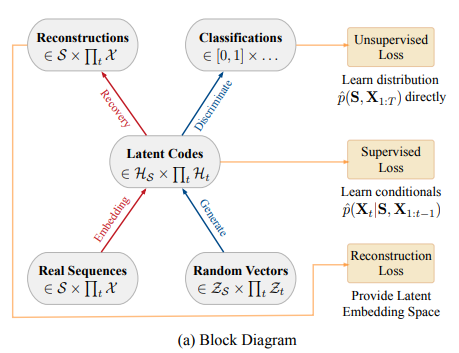
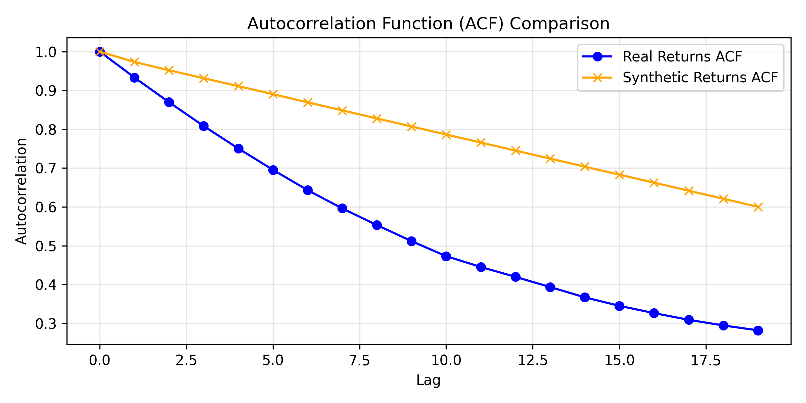
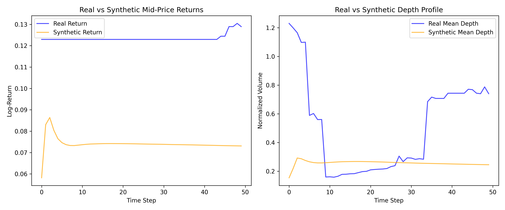

# Report on Time Series Model TimeGAN and predicting Limit Order Books
By Eric Yang

## Overview

This project aims to determine TimeGAN's effectivness on generating limit order books. Specifically, if TimeGAN's joint supervised temporal loss and unsupervised adversial loss can actually learn and enforce the hard structural constraints of a limit order book.

---

<div align="center">

</div>

TimeGAN paper: [Time-series Generative Adversarial Networks](https://proceedings.neurips.cc/paper_files/paper/2019/file/c9efe5f26cd17ba6216bbe2a7d26d490-Paper.pdf)

---

## Table of Content
1. [Introduction](#introduction)
2. [Dataset](#dataset)
3. [Models and Architectures](#models-and-architectures)
4. [Tests and Failed Models](#tests-and-failed-models)

## Introduction
This project took the TimeGAN model, as illustrated in the TimeGAN paper, and attempted to determine the effectiveness of joint loss functions on capturing the underlying distribution of limit order book. Limit order books are special as time is extremely important in the price of any given stock. Additonally, limit order books are extremely useful for a wide range of activities, from actual trading, to stress testing various algorithms. And such, we are attempting to test the timeGAN model on a very complex and vital piece of financial investing.

## Directory Structure
```
|-- README.md                          # Project documentation
|-- requirements.txt                   # Python dependencies
|-- dataset.py                         # Dataset loading and preprocessing
|-- modules.py                         # Model source code 
|-- train.py                           # Main training point
|-- predict.py                         # Inference and metric comparison script
|-- outputs                            # All experiment outputs
|   |
|   |-- real_lob_test.npy
|   |-- synthetic_lob_train.npy
```

---
## Algorithm
TimeGAN main algorithm is the joint supervised temporal loss and unsupervised adversarial loss.

**Supervised Temporal Loss:** Supervised temporal loss is crucial for time-series data because it forces the generator to learn the step-by-step temporal dynamics of the real data rather than just random static distributions.The goal of the supervised temporal loss is to learn the conditionals from the latent codes. 


**Unsupervised Adversarial Loss:** Unsupervised adversarial loss comes from the discriminator trying to distinguish between real latent sequences and synthetic ones. It pushes the generator to create realistic overall distributions. The goal of unsupervised adversarial loss is to learn the distribution directly from the classifications of the latent codes.

**Joint Supervised Loss and Unsupervised Loss:**
By combining gradients from both loss functions during backpropagation, the generator learns to produce sequences that are distributionally realistic and enforce the hard structural time constraints

---

## Dataset

### Dataset Structure
We are given two csv files to 

### Dataset Proprocessing and Sequence Creation


---
### First failed test with timesteps: 50 and iterations: 5000 (collapse into noise)
<div align="center">

</div>
<div align="center">

---


</div>
[Criterion 1] KL Divergence on Returns: 0.4861


[Criterion 2] Autocorrelation MSE: 0.071966